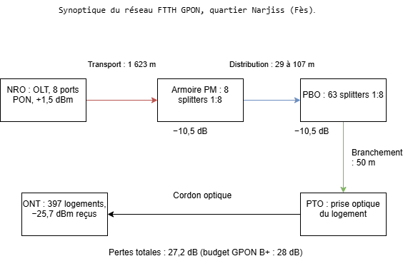
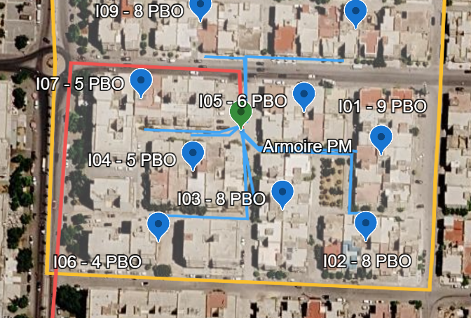

# Conception d'un réseau FTTH GPON – Quartier Narjiss (Fès)

Étude complète du raccordement en fibre optique de 397 logements d'un quartier résidentiel de Fès : comptage, dimensionnement, tracé des câbles, bilan optique et liste du matériel.

**Résultat : réseau validé, 27,2 dB de pertes pour un budget de 28 dB (GPON classe B+).**

## Chiffres clés

| Indicateur | Valeur |
| --- | --- |
| Logements desservis (îlots I01 à I09) | 397 |
| Architecture | GPON, deux niveaux de couplage 1:8 + 1:8 (taux 1:64) |
| Ports PON sur l'OLT | 8 |
| Boîtiers PBO | 63 |
| Capacité du réseau | 512 abonnés |
| Câble de transport (NRO → armoire PM) | 1 623 m |
| Câbles de distribution (PM → PBO) | 29 à 107 m, 577 m au total |
| Abonné le plus éloigné | 1,78 km de l'OLT (limite GPON : 20 km) |
| Pertes totales, pire cas | 27,22 dB (budget : 28 dB) |
| Puissance reçue par l'ONT, pire cas | −25,72 dBm (sensibilité : −27 dBm) |

## Démarche

1. **Zone d'étude** : délimitation du quartier dans Google Earth et découpage en 21 îlots.
2. **Comptage** : estimation des logements par îlot à partir de l'image satellite (884 logements sur la zone complète, 397 sur la zone retenue).
3. **Architecture** : choix du GPON avec deux niveaux de splitters 1:8.
4. **Dimensionnement** : calcul du nombre de PBO, de splitters et de ports PON, avec 20 % de réserve.
5. **Implantation et tracé** : placement du NRO, de l'armoire PM et des PBO, puis tracé des câbles le long des rues.
6. **Bilan optique** : calcul des pertes pour chaque îlot et vérification de la puissance reçue.
7. **Liste du matériel** : quantités d'équipements et de câbles.

*En rouge le câble de transport, en bleu les câbles de distribution, en vert l'armoire PM.*

## Bilan optique (pire cas, îlot I02)

| Poste | Calcul | Pertes (dB) |
| --- | --- | --- |
| Fibre G.652D | 1,780 km × 0,35 dB/km | 0,62 |
| Splitters 1:8 | 2 × 10,5 dB | 21,00 |
| Connecteurs | 4 × 0,5 dB | 2,00 |
| Épissures | 6 × 0,1 dB | 0,60 |
| Marge de sécurité | | 3,00 |
| **Total** | | **27,22** |

Les splitters représentent 77 % des pertes : dans un réseau d'accès de cette taille, c'est le taux de couplage, et non la distance, qui limite la conception.

## Contenu du dépôt

| Dossier | Contenu |
| --- | --- |
| `01_Cartographie/` | Fichier KML Google Earth (zone, repères, tracés) et captures de la carte |
| `02_Calculs/` | `Projet_FTTH_GPON_Narjiss.xlsx` : comptage, dimensionnement, longueurs, bilan optique, matériel |
| `03_Schemas/` | Synoptique du réseau (PNG et fichier draw.io) |
| `04_Rapport/` | Rapport complet du projet |

Pour visualiser la carte : ouvrir [Google Earth](https://earth.google.com/web/), puis Fichier > Importer un fichier KML.

## Outils

- **Google Earth** : cartographie, implantation, mesure des tracés
- **Microsoft Excel** : dimensionnement et bilan optique
- **draw.io** : schéma synoptique

## Limites et perspectives

- Le nombre de logements est estimé depuis l'image satellite, sans relevé de terrain.
- Les PBO sont regroupés au centre de chaque îlot et les branchements sont pris à 50 m en moyenne.
- L'emplacement du NRO est hypothétique.
- Extensions possibles : raccordement des îlots I10 à I21 (487 logements), évolution vers le XGS-PON, cartographie sous QGIS, chiffrage financier.

## Auteur

**Mohammed Benmeziane**, élève ingénieur à l'ENSA de Fès.

Projet personnel réalisé en novembre 2026.
